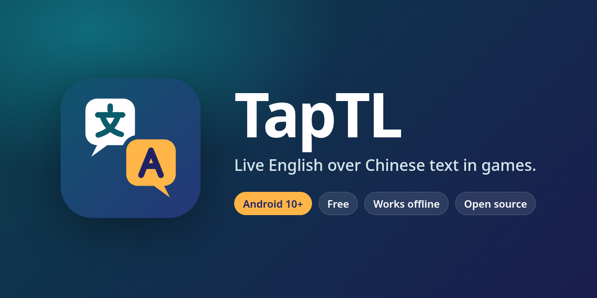
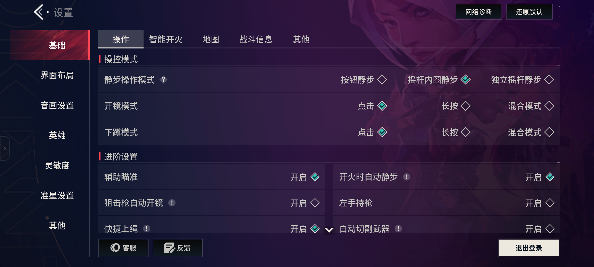
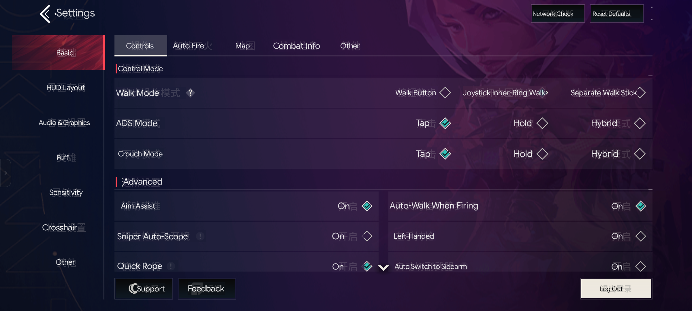
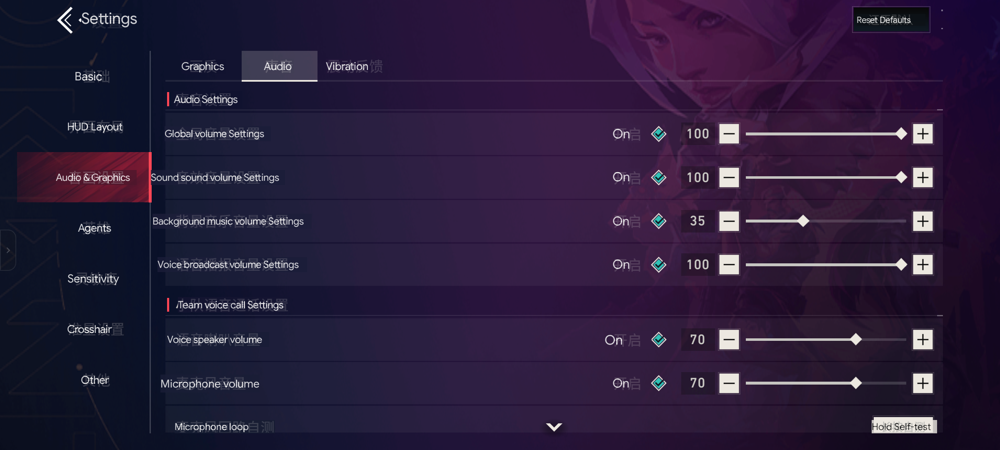
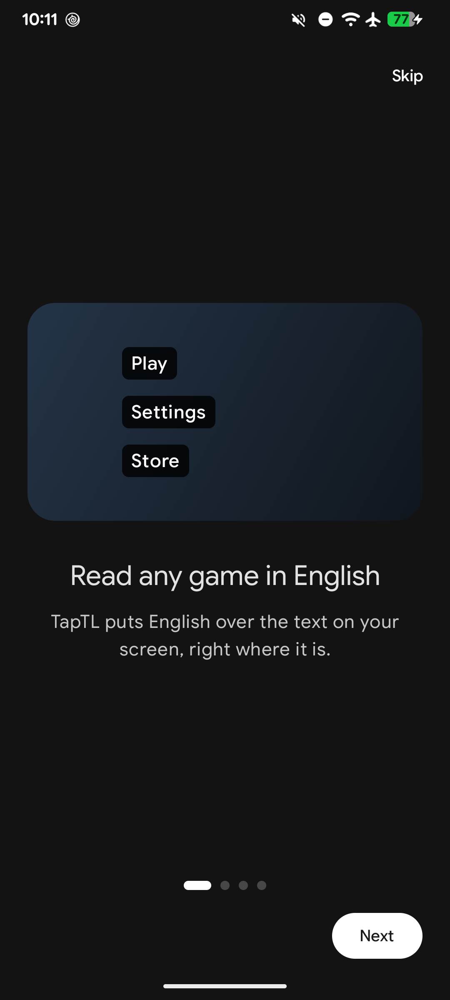
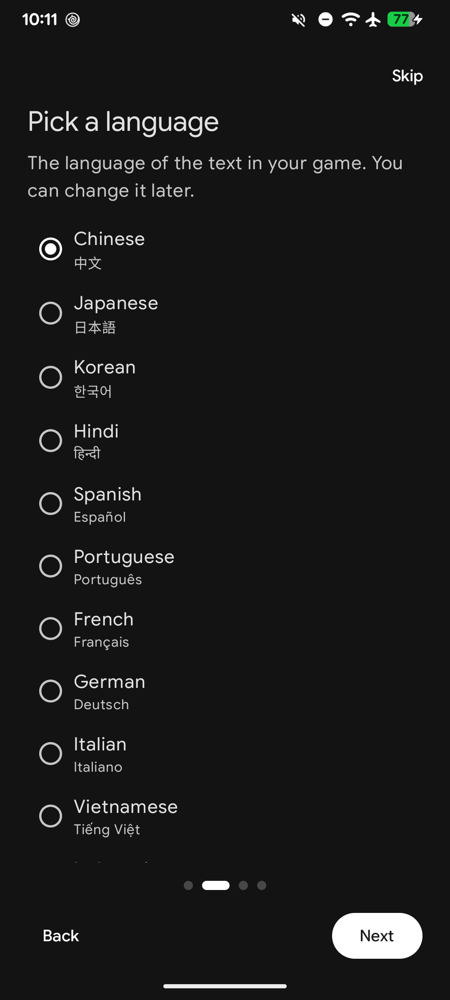
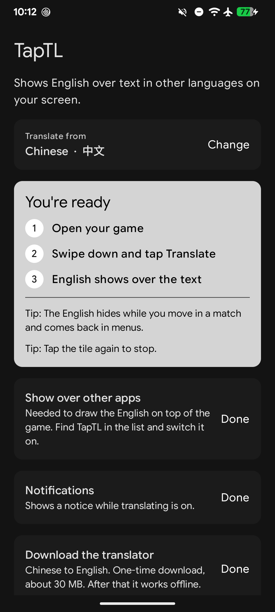

<div align="center">



<br>

[](https://developer.android.com/about/versions/10)
[](https://kotlinlang.org)
[](LICENSE)
[](https://github.com/dracu-lah/taptl/releases/latest)

**A live on-screen translator for games on Android. Any of 12 languages to English.**<br>
Built first for Valorant Mobile (CN, 无畏契约 源能行动), and it works with any app or game.<br>
Offline after setup. Turn it on and off from a Quick Settings tile.

[Website](https://taptl.pages.dev) · [Download](https://github.com/dracu-lah/taptl/releases/latest) · [Install](#install) · [Languages](#supported-languages) · [How it works](#how-it-works) · [FAQ](#faq) · [Build](#build)

[简体中文](README.zh-CN.md)

</div>

> [!WARNING]
> **Anti-cheat caveat.** TapTL only records the screen and draws on top of it. It doesn't read game memory, inject taps or use accessibility services. Even so, the game's anti-cheat may not like screen overlays. **Test on a secondary account first.**

## Screenshots

| Before | After |
|:---:|:---:|
|  |  |



| Intro | Pick a language | Setup |
|:---:|:---:|:---:|
|  |  |  |

### Demo videos

Recorded on a Poco F5 (Android 17), no editing:

- [Install and setup (1 min)](docs/videos/setup.mp4): the intro, picking a language and the setup steps.
- [In the game (75 s)](docs/videos/in-game.mp4): turning on the Translate tile, browsing the settings tabs in English, and turning it off.

## Why TapTL

Most game and screen translators need root, an Accessibility service, a cloud account, or a tap every time you want a translation. TapTL needs none of these: **no root, no Accessibility service, no internet after setup, and nothing touches the game.** It just watches the screen and puts English on top.

## Features

- **Free and offline.** On-device text reading (OCR) and on-device Google Translate (both ML Kit). After a one-time download, nothing goes online.
- **12 languages to English.** Pick yours on first launch, change it any time.
- **Works where you read.** Menus, settings, store, popups. It hides itself during gameplay.
- **Your taps still reach the game.** The overlay can't be touched.
- **One tap on, one tap off.** Start in the app or from a Quick Settings tile; stop from the tile or the notification. No floating buttons.
- **Light on battery.** It only does work when the screen changes.
- **Game words built in** for Valorant Mobile (CN): agents, weapons, maps and settings use the official English names.

## Supported languages

All text-reading models come inside the app. Each language's translator (about 40 MB) downloads once, then works offline.

| Language | Reads | Game word list |
|---|---|---|
| Chinese (中文) | Yes | Valorant Mobile CN |
| Japanese (日本語) | Yes | |
| Korean (한국어) | Yes | |
| Hindi (हिन्दी) | Yes | |
| Spanish (Español) | Yes | |
| Portuguese (Português) | Yes | |
| French (Français) | Yes | |
| German (Deutsch) | Yes | |
| Italian (Italiano) | Yes | |
| Vietnamese (Tiếng Việt) | Yes | |
| Indonesian (Bahasa Indonesia) | Yes | |
| Turkish (Türkçe) | Yes | |

Everything translates **to English**. The built-in game word list only covers Valorant Mobile CN for now; other languages use the translator alone.

## Download

Get the latest `app-release.apk` from **[GitHub Releases](https://github.com/dracu-lah/taptl/releases/latest)**, or [build it yourself](#build).

## Install

1. Get `app-release.apk` (from [Releases](https://github.com/dracu-lah/taptl/releases/latest), or see [Build](#build)) and open it on the phone. Allow "install unknown apps" if asked.
2. Open **TapTL**. A short welcome lets you pick your language, then the home screen lists what's left to set up:
   - **Show over other apps**: lets it draw the English on top of the game.
   - **Notifications**: shows a notice with a Stop button while translating is on (Android requires one).
   - **Language pack**: about 40 MB, once per language, with a progress bar. After that it works offline.
3. Optional: add the **Translate** tile when the home screen offers it (Android 13+ asks with one tap), or swipe down twice, tap the pencil and drag "Translate" in.

Language, permissions and the intro live under the gear icon (Settings).

## Use

- Tap **Start** in the app (or the **Translate** tile), then open the game. Android asks to share your screen every time; tap **Share screen**. This is an Android rule.
- English appears over the text about half a second after the screen stops moving. While a list scrolls, the boxes hide, then come back.
- Tap **Stop** in the notification or the app, tap the tile again, or stop sharing from the red status-bar chip. Locking the phone also turns it off.
- If an app blocks screen capture, TapTL tells you and turns itself off.

## Permissions

| Permission | Why |
|---|---|
| Display over other apps | Draws the English on top of the game. The overlay can't be touched, so taps go to the game. |
| Screen capture (asked each time) | Reads the text on screen. Frames stay on the phone. |
| Foreground service | Keeps capture running while the game is open, with a notice. |
| Notifications | That notice. |
| Internet | Only to download each language's translator once. |

Translations are automatic, by Google Translate (on-device), and can be wrong. For Valorant Mobile CN, game terms come from a built-in word list made from the official Valorant names.

## How it works

```
screen capture → only changed areas → read the text (OCR, on the phone) → word list / translate → overlay (hides while things move)
```

1. **Screen capture.** Android's normal screen sharing, at half size. Nothing leaves the phone.
2. **Only changed areas.** A tiny grayscale copy of each frame is compared with the last one. No change, no work. If the whole screen keeps moving (gameplay), the overlay hides.
3. **Read the text.** ML Kit reads only the parts that changed and keeps lines in your chosen language.
4. **Translate.** First the built-in game word list, then a cache, then Google Translate on the phone. Numbers and English stay as they are.
5. **Draw.** One see-through, untouchable layer puts English boxes over the original text, colored to match the background.

What it does **not** do: no accessibility service, no fake taps, no reading game memory.

## FAQ

**Which games does it work with?**
Any app or game that allows screen capture. It was built and tuned on Valorant Mobile CN (无畏契约 源能行动), so that game gets the best results.

**Does it need internet?**
Only once per language, to download the translator. After that it works fully offline.

**Why do I have to add the tile myself?**
Android requires you to confirm any Quick Settings tile. On Android 13 and newer, TapTL asks with one tap. On older versions, swipe down twice, tap the pencil and drag "Translate" in.

**Why does Android ask to share my screen every time?**
That's an Android rule (Android 14 and newer). Apps can't skip it.

**Is it safe with anti-cheat?**
TapTL only looks at the screen, like a screen recorder, and draws on top. It doesn't touch the game, its memory or your taps. Still, there's no guarantee: a game's anti-cheat can decide what it likes. Test on a secondary account first.

**Does it translate during a match?**
No. It hides during gameplay so it never covers what you need to see. It's for menus, settings, the store and popups.

**Can it translate into a language other than English?**
Not yet. Everything goes to English.

## Known limits

- Menus only. It hides during gameplay and does not translate in-match chat.
- Android 14 and newer ask "share your screen?" every time you turn it on.
- Some apps block screen capture. TapTL can't read those and turns itself off.
- Translations are machine-made and can be wrong or clumsy.
- English is the only output language. The game word list covers Valorant Mobile CN only.
- Only built for 64-bit ARM phones (almost every phone from the last few years).

## Build

Needs JDK 17+ (the build asks Gradle for JDK 21) and the Android SDK with platform 37.

```bash
./gradlew :app:assembleDebug        # app/build/outputs/apk/debug/app-debug.apk
./gradlew :app:assembleRelease      # app/build/outputs/apk/release/app-release.apk
```

Release signing reads `~/.android/taptl-keystore.properties` (outside the repo):

```properties
storeFile=/home/you/.android/taptl-release.jks
storePassword=...
keyAlias=taptl
keyPassword=...
```

Without that file the release APK is unsigned. Make a key with:

```bash
keytool -genkeypair -keystore ~/.android/taptl-release.jks -alias taptl -keyalg RSA -keysize 4096 -validity 10000
```

Regenerate the game word list (needs `kotlinc`):

```bash
kotlinc -script tools/build_glossary.kts
```

Debug log:

```bash
adb logcat -s TapTL
```

## Website

The site at **[taptl.pages.dev](https://taptl.pages.dev)** lives in [`site/`](site): plain HTML and CSS, no build step, deployed with Cloudflare Pages. See [`site/README.md`](site/README.md).

## Contributing

Bug reports, word list fixes and small pull requests are welcome. Read [CONTRIBUTING.md](CONTRIBUTING.md) first.

## License

[MIT](LICENSE) © 2026 Nevil ([dracu-lah](https://github.com/dracu-lah)).

Translations by Google Translate (ML Kit, on-device). Text reading by ML Kit. Valorant is a trademark of Riot Games. TapTL is not made by or linked to Riot Games or Tencent.
